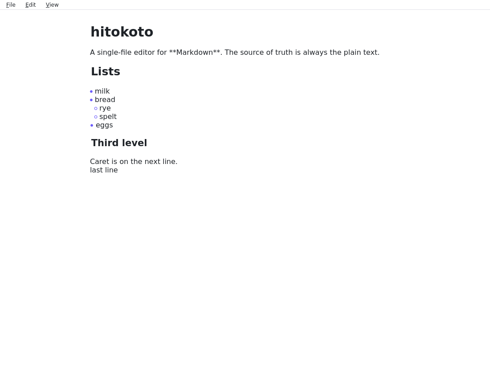

# hitokoto

**hitokoto** (一言, "a single word") is a fast, native desktop Markdown editor for one file at a
time, with Obsidian-style live preview: the document is always plain Markdown, rendered inline as
you type, with raw syntax revealed only on the active line.

> **About this project:** hitokoto is an experiment to test out human-driven AI development and see
> how it holds up in practice. Instead of unguided generation, a human sets the product vision, hard
> constraints, architecture gates, and acceptance criteria ([`docs/brief.md`](docs/brief.md)), while
> coding agents write the ADRs, tests, and C++/Qt implementation story by story under strict TDD,
> linting, and performance budgets ([`CLAUDE.md`](CLAUDE.md), [`docs/stories/`](docs/stories/)).



## Usage

```sh
hitokoto notes.md                 # open a file
hitokoto                          # start with an empty document
hitokoto --theme my-theme.toml    # use a custom theme (see docs/theming.md)
```

## Building

Requires a C++20 compiler, CMake 3.25+, and Qt 6.8+ (Core, Gui, Widgets, Svg; Test for tests).

```sh
# Release build
cmake --preset release
cmake --build --preset release

# Development build & tests (core + headless UI tests)
cmake --preset dev
cmake --build --preset dev
ctest --preset dev
```

On Windows or macOS (or with a custom Qt install), pass `-DCMAKE_PREFIX_PATH=/path/to/Qt` when
configuring. On Debian 13+, install `build-essential cmake ninja-build qt6-base-dev qt6-svg-dev qt6-wayland`.

For packaging/distributable builds, see [`docs/stories/012-distributable-builds.md`](docs/stories/012-distributable-builds.md) (`windeployqt` on Windows, `macdeployqt` on macOS, `linuxdeploy` on Linux).

## Documentation

- [`CLAUDE.md`](CLAUDE.md) — Working agreement for coding agents
- [`docs/brief.md`](docs/brief.md) — Original human brief and constraints
- [`docs/architecture.md`](docs/architecture.md) & [`docs/adr/`](docs/adr/) — Architecture and decision records
- [`docs/stories/`](docs/stories/) — Story backlog and acceptance scenarios
- [`docs/theming.md`](docs/theming.md) — Theme file reference
- [`docs/performance.md`](docs/performance.md) — Performance budgets and benchmarks

## License

GPL-3.0-or-later (see [`LICENSE`](LICENSE)). Uses Qt under the LGPLv3.
