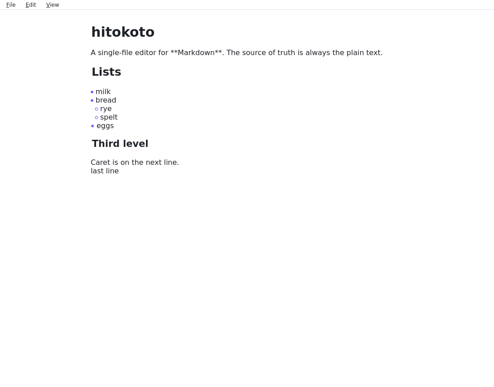

# hitokoto

**hitokoto** (一言, "a single word") is a fast, native desktop Markdown editor for one file at a
time, with Obsidian-style live preview: the document is always plain Markdown, rendered inline as
you type, with raw syntax revealed only on the active line.

> **About this project:** hitokoto is an experiment to test out human-driven AI development and see
> how it holds up in practice. Instead of unguided generation, a human sets the product vision, hard
> constraints, architecture gates, and acceptance criteria ([`docs/brief.md`](docs/brief.md)), while
> coding agents write the ADRs, tests, and C++/Qt implementation story by story under strict TDD,
> linting, and performance budgets ([`CLAUDE.md`](CLAUDE.md), [`docs/stories/`](docs/stories/)).



## Usage

```sh
hitokoto notes.md                 # open a file
hitokoto                          # start with an empty document
hitokoto --theme my-theme.toml    # use a custom theme (see docs/theming.md)
hitokoto --version                # show the version (on Windows a message box, unless redirected)
```

## Building

Requires a C++20 compiler, CMake 3.25+, and Qt 6.8+ (Core, Gui, Widgets, Svg; Test for tests).

```sh
# Release build
cmake --preset release
cmake --build --preset release

# Development build & tests (core + headless UI tests)
cmake --preset dev
cmake --build --preset dev
ctest --preset dev
```

On Windows or macOS (or with a custom Qt install), pass `-DCMAKE_PREFIX_PATH=/path/to/Qt` when
configuring. On Debian 13+, install `build-essential cmake ninja-build qt6-base-dev qt6-svg-dev qt6-wayland`.

For packaging/distributable builds, see [`docs/stories/012-distributable-builds.md`](docs/stories/012-distributable-builds.md) (`windeployqt` on Windows, `macdeployqt` on macOS, `linuxdeploy` on Linux).

## Versions

Every pull request merged into main gives hitokoto its version step (story S030,
[ADR 0010](docs/adr/0010-versions-from-pull-request-labels.md)):

- **Exactly one label per pull request into main**, checked by "Version label":
  - `version:none`: no functional change, only documentation (stories, notes, reviews, README,
    `docs/`) or infrastructure (CI, workflows, build scripts, tests, tooling); no new version.
  - `version:patch`: fixes, follow-up work and refactoring of what ships, build changes that change
    the built program. Anything that ships in the program (`src/`, themes, icons) is at least
    `version:patch`.
  - `version:minor`: something new for users, typically a finished story, or compatible changes of
    behaviour.
  - `version:major`: incompatible for users, or the step to 1.0; not used while the version starts
    with 0 (incompatible changes are `version:minor` until then).

  The label is part of the review before the merge and must fit the pull request's final content,
  not only what it was opened for. The check takes its rules (`scripts/version/NextVersion.cmake`)
  from main's tip, not from the pull request (S032): a pull request that changes them is checked
  with main's rules, and its own apply from the next pull request on.
- **The tag is the only source of the version.** After the merge, the workflow `version.yml` puts
  an annotated tag `vMAJOR.MINOR.PATCH` on the merge commit. `project()` in `CMakeLists.txt`
  carries no `VERSION`, and nobody sets a `v*` tag by hand (apart from the starting tag `v0.3.0`):
  a tag set by hand would become the base of every later version.
- **Builds** take the version from `git describe` when CMake configures: `0.4.0` on the tagged
  commit, `0.4.0+3.gabc1234` three commits later; uncommitted changes add `.dirty`
  (`0.4.0+3.gabc1234.dirty`, on the tagged commit itself `0.4.0+dirty`). The
  version is that of the last configure; a build that does not reconfigure (Visual Studio in folder
  mode, `cmake --build` after a pull) keeps the old one. Without git (a source archive), or in a
  checkout without tags, configure with `-DHITOKOTO_VERSION=0.4.0`; otherwise the version is
  `0.0.0+unknown` and CMake warns. Configure prints the version and where it came from. The option
  stays in the cache of the build directory and wins over git; in a checkout with a version tag
  CMake warns about it. Remove it with `-DHITOKOTO_VERSION=` (or configure with `--fresh`).
- **Changes reach main only through pull requests**, also notes and status changes (with
  `version:none`).

## Documentation

- [`CLAUDE.md`](CLAUDE.md) — Working agreement for coding agents
- [`docs/brief.md`](docs/brief.md) — Original human brief and constraints
- [`docs/architecture.md`](docs/architecture.md) & [`docs/adr/`](docs/adr/) — Architecture and decision records
- [`docs/stories/`](docs/stories/) — Story backlog and acceptance scenarios
- [`docs/theming.md`](docs/theming.md) — Theme file reference
- [`docs/performance.md`](docs/performance.md) — Performance budgets and benchmarks

## License

GPL-3.0-or-later (see [`LICENSE`](LICENSE)). Uses Qt under the LGPLv3.
