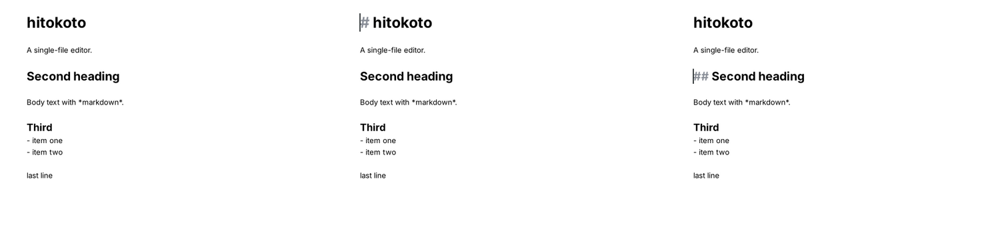
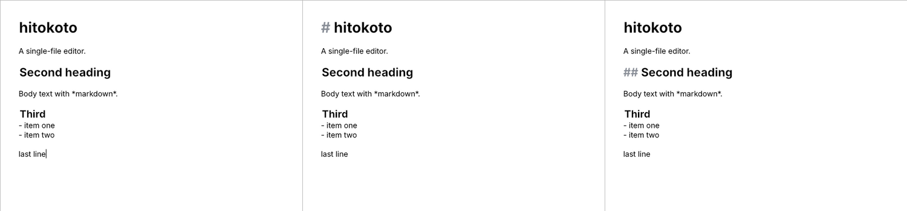

# ADR 0001: Technology stack

- **Status:** Accepted
- **Date:** 2026-10-24 (proposed and accepted)
- **Deciders:** project owner

## 1. Context

hitokoto is a single-file Markdown editor with Obsidian-style hybrid live preview: the
document is always plain Markdown text, rendered inline, with syntax markers revealed only
where the cursor is. The brief fixes the hard constraints (no web technology, no JavaScript
tooling, one codebase for Linux/Windows/macOS, native Wayland plus X11), strict performance
budgets (cold start < 1 s, keystroke-to-screen within one frame, 10 MB files usable), deep
theming from plain-text theme files, and a strong preference for one language and a small,
healthy dependency set.

The hardest part is the editing surface: variable font sizes per line, hidden/revealed
markers, cursor-aware re-rendering, IME, accessibility and large files. A toolkit that is
pleasant everywhere else but weak here is not acceptable.

## 2. Decision drivers (in priority order)

1. A mature text-editing surface: IME, accessibility, caret/selection, large documents.
2. Equal quality on Linux (Wayland and X11), Windows and macOS.
3. Performance: startup, latency, memory, no idle CPU.
4. Long-term health of every critical-path dependency.
5. One language, one coherent build and styling system.
6. Theming that works with the toolkit, not against it.
7. Extensibility for the planned features (inline elements, tables, images, search, spellcheck, export, plugins, localisation).

## 3. Candidates

Seriously considered (detailed below): **A** C++20 + Qt 6 Widgets, **B** Rust + GTK 4 (gtk4-rs),
**C** Rust + Slint, **D** Rust + iced.

Screened out early:

| Option | Reason for early rejection |
|---|---|
| Qt Quick / QML | QML evaluates JavaScript expressions; the brief tolerates it only reluctantly, and `TextArea` is weaker than the Widgets text stack for large documents. Widgets give the same Qt quality without JS. |
| C# + Avalonia + AvaloniaEdit | AvaloniaEdit's element generators would suit hidden markers well, but native Wayland in Avalonia 12.1 (July 2026) is still experimental and not selected by default. Fails constraint 3 for now. |
| Dart + Flutter | Not web technology, but the editable text model is one paragraph per field (a 10 MB file means one huge layout), there is no hidden-text attribute, and desktop stewardship moved from Google to Canonical in May 2026, so the desktop roadmap is in transition. |
| Rust + egui | Immediate mode; `TextEdit` lays out the whole text on change, unsuited to 10 MB files; hidden text only via hacks. |
| Rust + GPUI (Zed) | Excellent text rendering, but built for Zed; not a stable, general-purpose dependency with a compatibility promise. |

### A. C++20 + Qt 6 Widgets

- **Hybrid editor:** `QPlainTextEdit` (block-based layout, scales to large files) with formats
  set per block via `QTextLayout`. Headings: larger font in the block's formats. Cursor-aware
  reveal: on cursor move, re-format only the old and new block. **Weak point:** Qt has no
  "invisible" character format; markers are hidden by a 1 px transparent font (the spike shows
  about 1 px residue per hidden character, and hidden characters stay in the layout). Bullet dots
  would be painted in `paintEvent` over the concealed marker. Clean alternative (plan B): our own
  surface on `QAbstractScrollArea` + `QTextLayout` per line, with IME via
  `inputMethodEvent`/`inputMethodQuery` and accessibility via `QAccessibleTextInterface`.
- **Wayland:** native via the `qtwayland` platform plugin, X11 via `xcb`; both verified in the spike.
- **Windows/macOS:** first-class; Qt is one of the most widely deployed cross-platform toolkits.
- **Theming:** `QPalette` + Fusion style + Qt Style Sheets (QSS), all native to Qt. Coherent if one
  base style (Fusion) is used and all styling comes from one source (our theme tokens).
- **Text/IME/accessibility:** mature on all three platforms (UIA on Windows, NSAccessibility on
  macOS, AT-SPI on Linux); IME through each platform's input method framework.
- **Performance (spike):** first frame ~50–70 ms, RSS ~34 MB (X11, raster); 10 MB file needs a
  replacement for `QSyntaxHighlighter`'s synchronous whole-document pass (see section 6).
- **Build/packaging:** CMake; `windeployqt`, `macdeployqt` (+ codesign/notarisation), AppImage,
  Flatpak (KDE runtime), `.deb` via CPack. Debian trixie ships Qt 6.8.2, testing 6.11.2.
- **Testing:** Qt Test with `QT_QPA_PLATFORM=offscreen` (verified: the spike renders headless,
  first frame 21 ms), `QTest::keyClicks`, `QWidget::grab()` for snapshot tests.
- **Dependency health:** The Qt Company plus the open Qt Project (KDE is a major contributor);
  two minor releases per year; Qt 6.12 LTS released 2026-09-30, standard support until
  2031-09-30. Licences LGPLv3 / GPL / commercial. Very large user base. Breaking changes only at
  major versions (5→6 in 2020), source compatibility within Qt 6. Caveat: LTS patch releases
  become commercial-only after the first year (6.8 LTS is now commercial-only), so open-source
  users should follow current minor releases.
- **Risks:** concealment hack (mitigated by plan B behind our interface); C++ memory safety
  (mitigated by sanitizers, clang-tidy, fuzzing); Qt's investment focus is QML, Widgets are
  maintained but evolve slowly; the official Qt installer needs an account (CI uses distribution
  packages or a maintained installer action).

### B. Rust + GTK 4 (gtk4-rs)

- **Hybrid editor:** `GtkTextView`/`GtkTextBuffer` with tags. `invisible = true` hides markers
  cleanly and the caret skips invisible text natively; `scale` gives heading sizes. Bullets: hide
  the marker and draw the dot in the view's snapshot. **This is the cleanest hybrid implementation
  of all candidates.**
- **Wayland:** first-class (GTK is Wayland-native); verified in the spike.
- **Windows/macOS:** works, but second-class: non-native look, macOS backend less mature,
  accessibility on Windows/macOS only through the AccessKit backend merged in GTK 4.18, opt-in
  at build time (`-Daccesskit=enabled`) and runtime (`GTK_A11Y=accesskit`).
- **Theming:** GTK CSS (CSS syntax, but GTK's own engine, not web CSS); coherent. libadwaita would
  pull the look toward GNOME HIG and should be avoided.
- **Performance (spike):** first frame ~260–330 ms with the GL renderer on software rendering
  (~125 ms with the Cairo renderer), RSS 99–171 MB; heavier runtime than Qt.
- **Build/packaging:** cargo; on Windows and macOS the GTK runtime must be bundled (gvsbuild /
  MSYS2, gtk-mac-bundler), which is the weakest part of this option.
- **Testing:** Rust unit tests and proptest are excellent; headless UI tests possible with the
  Broadway or a headless Wayland compositor, less turnkey than Qt's offscreen platform.
- **Dependency health:** GTK by the GNOME project, two releases per year (4.20 Aug 2025, 4.22
  Mar 2026), LGPL-2.1+, a small core team. gtk4-rs by the gtk-rs team (several maintainers),
  0.11.x in 2026, MIT; breaking changes with each 0.x minor, roughly yearly.
- **Risks:** Windows/macOS quality and packaging; accessibility outside Linux still young.

### C. Rust + Slint

- **Hybrid editor:** `TextEdit` holds plain text without styled spans; `StyledText` (since 1.16,
  April 2026) is display-only and described by Slint as "a first step toward full rich text
  support". A hybrid editor would need a custom text surface (own layout, caret, IME, a11y).
- **Wayland/Windows/macOS:** good via winit; no JavaScript (the `.slint` language is not JS).
- **Theming:** styles and global properties in `.slint`; user themes would need a runtime mapping.
- **Dependency health:** SixtyFPS GmbH, stable 1.x API, regular releases (1.17 in June 2026);
  licences GPLv3 / royalty-free / commercial.
- **Verdict:** a pleasant toolkit with an immature editing story for exactly our hardest part.
  Rejected for now; worth re-checking once rich-text editing lands.

### D. Rust + iced

- **Hybrid editor:** `text_editor` supports highlighting via a highlighter trait; input-method
  support only arrived in 0.14 (December 2025). Hiding characters and per-line font sizes would
  need a custom widget on cosmic-text.
- **Dependency health:** pre-1.0, breaking changes in every release, no 1.0 date; development
  centred on one lead maintainer; System76's libcosmic is a large downstream user.
- **Verdict:** rejected: API instability and editing maturity are critical-path risks.

### Comparison

| Criterion | A Qt 6 Widgets | B GTK 4 | C Slint | D iced |
|---|---|---|---|---|
| Hidden markers | hack or custom surface | native (`invisible`) | custom surface | custom widget |
| IME | mature, all OS | mature on Linux | basic | new (0.14) |
| Accessibility | mature, all OS | Linux mature; Win/mac opt-in | partial | limited |
| Native Wayland | yes | yes | yes | yes |
| Windows/macOS quality | excellent | fair | good | good |
| Startup / memory (spike) | ~50 ms / ~34 MB | ~125–330 ms / 99–171 MB | – | – |
| API stability | high | medium (0.x bindings) | high | low |
| Language | C++ | Rust | Rust | Rust |
| JS involved | no (Widgets) | no | no | no |

## 4. Decision

**C++20 with Qt 6 Widgets, built with CMake, one language for core and UI.**

- **Qt version:** build releases against the latest Qt 6 minor (6.12 LTS today); keep source
  compatible down to Qt 6.8 so distribution builds on Debian trixie work.
- **Layering:** `core` is plain C++20 with the standard library only (no Qt types); `ui` is the
  only layer that includes Qt. The editor surface is an adapter behind our own interface, fed by
  core output per block: style runs, concealed ranges and decorations (e.g. "draw bullet here").
- **Editor surface:** start with a `QPlainTextEdit`-based adapter that applies formats per block
  directly via `QTextLayout` (not `QSyntaxHighlighter`, which re-highlights the whole document)
  and conceals markers with the contained 1 px technique. Switch to the custom
  `QAbstractScrollArea` + `QTextLayout` surface (plan B) if concealment artifacts, caret
  geometry or accessibility turn out unacceptable; core and tests stay unchanged. This check is
  proposed as an early story.
- **Markdown parsing:** our own rule engine in core (one parse rule + one render rule per element,
  registered, not hard-wired). The MVP elements are line-local. When nested/inline CommonMark
  constructs arrive, evaluate `cmark` (the CommonMark reference implementation) behind the same
  interface.
- **Theming:** a plain-text token file (TOML-like subset: colours, fonts, sizes, heading scale,
  radii, spacing, marker style), parsed and validated by our own small parser in core, with line
  and column in error messages and fallback to the built-in default. The UI maps tokens to Fusion +
  `QPalette` + generated QSS + editor formats. Users never write QSS directly, so there is exactly
  one styling source and no clash between native styles and style sheets. Only the active theme
  is parsed at startup.
- **Dependencies:** runtime: Qt Core, Gui, Widgets (plus the Wayland plugin on Linux). Development
  only: GoogleTest, Google Benchmark, libFuzzer (part of LLVM). Nothing else on the critical path.
- **Quality gates:** clang-format, clang-tidy, warnings as errors, ASan/UBSan builds in CI,
  fuzzing of core (arbitrary text and cursor positions), benchmarks with regression thresholds on
  Linux, Windows and macOS.

### Why not GTK, despite the cleaner hidden-text model

GTK is the best fit for the hybrid surface itself and Rust would be a plus for maintainability.
But the brief asks for equal quality on three operating systems, accessibility, fast startup and
low memory on modest hardware. GTK's Windows/macOS story (packaging, look, accessibility only via
an opt-in backend) and its heavier runtime cost more than Qt's concealment workaround, which can
be replaced inside one adapter.

## 5. Accepted trade-offs

- C++ instead of a memory-safe language; mitigated by tooling and a small, well-tested core.
- Concealment via a workaround in the first adapter, with a planned exit (plan B).
- The app does not use each platform's native widget style; it uses one themed Fusion look,
  which matches the brief's flat, Obsidian-like design goal.
- Open-source Qt users do not get LTS patches beyond the first year; we follow current minors.
- Clicking on a heading line reveals its markers and shifts the text under the pointer (Obsidian
  behaves the same); to be designed in the stories, not a stack issue.

## 6. Spike results

Environment: cloud VM, 2 vCPU x86-64, 7 GiB RAM, **no GPU** (Mesa llvmpipe), Ubuntu 24.04 with
distribution GTK 4.14.5 and Qt 6.4.2 (older than the versions we would ship), Xvfb for X11 and
weston 13 headless for Wayland. These are **indicative numbers, not the budget measurement on
modest real hardware**; that is the first performance story. The spike code was throwaway and
is not part of this repository; it is archived outside the repo (`hitokoto-phase0.zip`).

| Measurement | GTK, GL renderer | GTK, Cairo renderer | Qt Widgets (raster) |
|---|---|---|---|
| Cold start to first frame, X11, warm cache | 267–309 ms | 125–134 ms | 47–67 ms |
| Cold start, native Wayland (weston headless) | 329–336 ms (893 ms first run) | – | 76–119 ms |
| RSS at first frame (X11) | ~171 MB | ~99 MB | ~34 MB |
| First frame with 1 MB file | 332–345 ms | – | 117 ms |
| First frame with 10 MB file | 642–706 ms | 637 ms | 651–742 ms |
| RSS with 10 MB file | ~209 MB | ~137 MB | ~142 MB |
| Key→paint, small file (median / p95 / max) | 12.8 / 20.1 / 22.9 ms | 9.5 / 16.9 / 20.2 ms | 1.2 / 1.9 / 3.6 ms |
| Key→paint, 10 MB file (median / p95 / max) | 10.4–12.1 / 24.7–26.1 / 47.8–189.9 ms | 10.4 / 20.7 / 25.6 ms | 2.2 / 3.8 / 6.0 ms |
| Spike code (incl. instrumentation) | 263 lines Rust | (same) | 113 lines C++ |
| Hackiness | none: `invisible` tag | none | 1 px transparent font, ~1 px residue per hidden char |

Notes:

- Key→paint covers 190 real X11 key events (typing, Enter, `## Title` lines, Up/Down across
  headings, i.e. including reveal/hide). GTK paints on its frame clock, so its numbers include up
  to 16.7 ms of waiting for the next frame tick; Qt Widgets repaint immediately on Xvfb. The
  columns are therefore not directly comparable; neither stack showed visible lag.
- The GTK outlier of 190 ms on the 10 MB file happened in one of two runs, early after load,
  likely while GtkTextView was still validating layout in idle time.
- Both spikes load and style the whole file synchronously: GTK ~150 ms `set_text` + ~150 ms
  styling of 14 387 headings; Qt ~550–610 ms because `QSyntaxHighlighter` runs over all blocks
  at once. The real implementation must read off the UI thread, show the first screen first, and
  style lazily (visible blocks first, the rest in idle chunks). With that, the 10 MB budget
  (2–3 s) looks reachable with either stack.
- A first-ever run after installing GTK took 1.97 s (cold disk cache); not repeated for Qt.
  Cold-cache start is part of the real-hardware story.
- Screenshots (cursor at end, on H1, on H2):

  
  

## 7. What would make us reconsider

- The concealment workaround and plan B together cost more than about two stories, or plan B
  cannot provide acceptable IME/accessibility → re-evaluate GTK 4 (+ Rust).
- Windows/macOS drop out of scope → GTK 4 + Rust becomes the better choice.
- Real-hardware measurements miss the budgets in ways tied to Qt (not to our code).
- Qt licensing changes for the open-source edition, or Qt Widgets lose active maintenance.
- Slint gains rich-text editing with IME and accessibility, or iced reaches a stable 1.0 with a
  mature editor; re-check yearly.
- Qt's experimental StyleKit (Qt Labs, 6.12) becomes stable and usable from Widgets without
  QML; it could replace generated QSS.

## 8. Sources (checked 2026-10-24)

- Qt releases and support dates: https://doc.qt.io/qt-6/qt-releases.html
- Qt 6.12 LTS release: https://www.phoronix.com/news/Qt-6.12-LTS-Released
- Qt in Debian: https://tracker.debian.org/pkg/qt6-base-dev
- GTK AccessKit backend: https://blogs.gnome.org/gtk/2025/05/12/an-accessibility-update/
- GTK 4.20: https://phoronix.com/news/GTK-4.20-Released ; GTK 4.22: https://www.phoronix.com/news/GTK-4.22-Released
- gtk4-rs 0.11: https://docs.rs/crate/gdk4/0.11.4
- Slint 1.16 (StyledText): https://slint.dev/blog/slint-1.16-released ; 1.17: https://newreleases.io/project/github/slint-ui/slint/release/v1.17.0
- iced releases: https://github.com/iced-rs/iced/releases ; roadmap discussion: https://discourse.iced.rs/t/just-wondering-how-iceds-development-is-coming-along/1197
- Avalonia 12.1 (Wayland experimental): https://avaloniaui.net/blog/release-12-1
- Flutter desktop stewardship: https://www.omgubuntu.co.uk/2026/05/flutter-desktop-canonical-maintained
